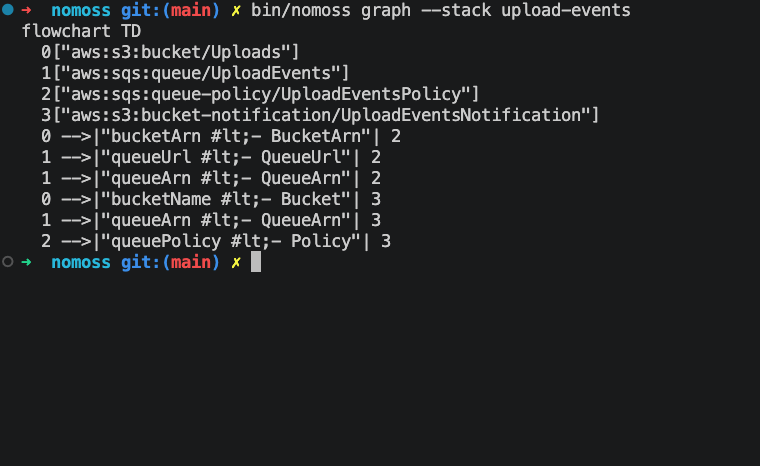

# Nomoss

Nomoss lets TypeScript applications declare infrastructure, inspect proposed changes, and apply them through Effect services in the application runtime.



Keep resource declarations beside application code and pass their typed output references into dependent declarations. Nomoss waits for each source resource before it sends the dependent request. After execution, saved state retains the provider identity so later commands can read or change the same object.

Nomoss generates AWS operation contracts from official Smithy models and Stripe clients from Stripe's public OpenAPI specification. AWS resource declarations use CloudFormation Registry schemas and execute through the generated Cloud Control client. Stripe policies call generated clients through the shared provider runtime.

Applications supply credentials, persistence, and platform services through Layers. Tests can provide controlled external effects to the production lifecycle services, while live integration workflows verify provider behavior and cleanup.

## Example

[The queue example](examples/queue/stack.ts) declares one SQS queue through its generated Cloud Control definition.

The [output API](docs/application/resource-outputs.md) shows how generated references connect resources and how applications read schema-decoded values from applied state.

## CLI

Applications bind the Nomoss command tree to their stack definition and provider Layers in a project entry point. The [queue runtime](examples/queue/runtime.ts) supplies its AWS region and shares one declaration and execution graph. Its [CLI entry point](examples/queue/cli.ts) runs the command tree with the installed Nomoss version.

The repository's nomoss script runs that queue application:

```sh
yarn nomoss diff
yarn nomoss create
yarn nomoss update
yarn nomoss reconcile
yarn nomoss destroy
```

Create and update apply the desired application stack configuration. Diff displays the current plan, reconcile refreshes saved state from provider observations, and destroy removes the managed stack. Application projects can expose the same commands through a script such as yarn infra diff.

The [CLI guide](docs/application/cli-workflow.md) explains these commands and their current limitations.

## Documentation

[Resource mappings](docs/application/resource-mapping.md) specify which response fields Nomoss saves and how it places those values into later read requests. The [generation architecture](docs/application/generation-architecture.md) explains how declarations and provider requests use generated contracts. The [documentation index](docs/README.md) separates application specifications, development-process rules, and operational procedures.

## Status

The [tracing contract](docs/application/tracing.md) and [observability procedure](docs/operations/observability-sop.md) describe Jaeger export and investigation of live integration timing.

Nomoss is early software. Its public API and provider coverage will evolve as it is used inside real TypeScript projects.

## License

MIT
