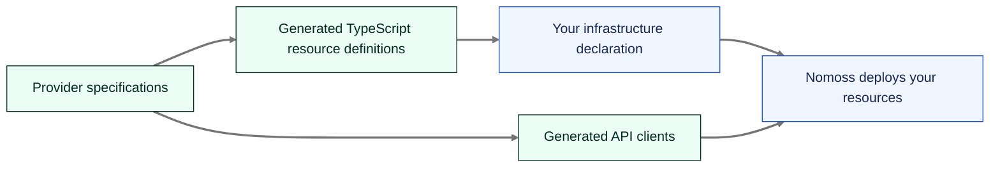

# Nomoss

## Declarative TypeScript resources from OpenAPI

Nomoss is an infrastructure management tool. It generates TypeScript resource declarations and clients from provider specifications so applications use the provider's types and validation rules.

The stack uses shared lifecycle services to apply the declarations. A resource definition selects the provider operations and supplies the mappings those operations need. A provider rule that requires its own decisions or sequence can use a typed [Effect](https://effect.website/) operation. When the provider specification changes, contributors can regenerate the corresponding types and validators together.



## Status

Experimental version.

The beta goal is full AWS and Stripe resource coverage, with no AWS SDK dependencies. Nomoss plans to publish the generated clients as separate packages.

## Demo


## CLI

Run `yarn nomoss --help` to list the example stacks. Pass the stack name before the command.

```sh
yarn nomoss queue diff
```

For stacks that support deployment, use `create` to deploy, `update` to apply changes, `reconcile` to refresh saved state, and `delete` to remove managed resources. The [example guide](examples/README.md) lists the commands each example supports. The [CLI guide](docs/application/cli-workflow.md) explains plan review, progress, and saved state.

## Documentation

- [Run an AWS or Stripe example](examples/README.md)
- [Use one resource in another declaration](docs/application/resource-graph.md)
- [Read resource outputs after deployment](docs/application/resource-outputs.md)
- [How Nomoss generates clients and resources](docs/application/generation-architecture.md)
- [Documentation index](docs/README.md)

## Roadmap

[Planned features](ROADMAP.md)

## License

MIT
