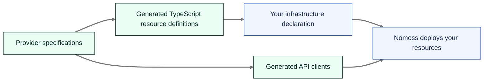

# Nomoss

## Declarative TypeScript resources from OpenAPI

Nomoss (as in “don’t let your infra grow moss”) is an infrastructure management tool. Unlike IaC tools with handwritten resource definitions, Nomoss generates TypeScript SDKs and resource definitions from provider specifications.

Nomoss has distinct advantages over traditional IaC:

- Resource authors reuse the provider's validation rules. They write custom code only for rules the specification leaves out.
- When a provider changes a field, resource authors can update the source specification and regenerate the affected TypeScript types and validators together.
- New resources take only a few hours for an agent to add with tokens usage minimized

Nomoss uses [Effect](https://effect.website/) to compile OpenAPI specifications into typed clients with runtime validation. Its core calls those clients to bring deployed resources into line with their declarations.



## Status

Experimental version.

Goal: beta version with full AWS and Stipe resources coverage and 0 AWS SDK dependencies. SDK generated packages separate publish.

## Demo


## CLI

Run `yarn nomoss --help` to list the example stacks. Pass the stack name before the command.

```sh
yarn nomoss queue diff       # Preview the proposed changes
yarn nomoss queue create     # Deploy a new stack
yarn nomoss queue update     # Apply changes to a deployed stack
yarn nomoss queue reconcile  # Refresh saved state from AWS
yarn nomoss queue delete     # Remove the stack's managed resources
```

The [CLI guide](docs/application/cli-workflow.md) covers detailed diffs, live progress, and saved state.

## Documentation

- [Run an AWS or Stripe example](examples/README.md)
- [Use one resource in another declaration](docs/application/resource-graph.md)
- [Read resource outputs after deployment](docs/application/resource-outputs.md)
- [How Nomoss generates clients and resources](docs/application/generation-architecture.md)
- [Documentation index](docs/README.md)

## Roadmap

[Planned features](ROADMAP.md)

## License

MIT
