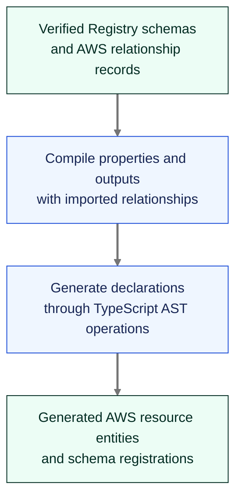
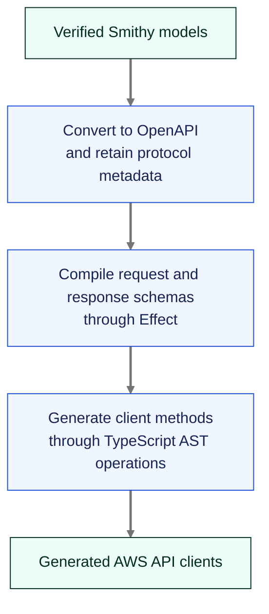
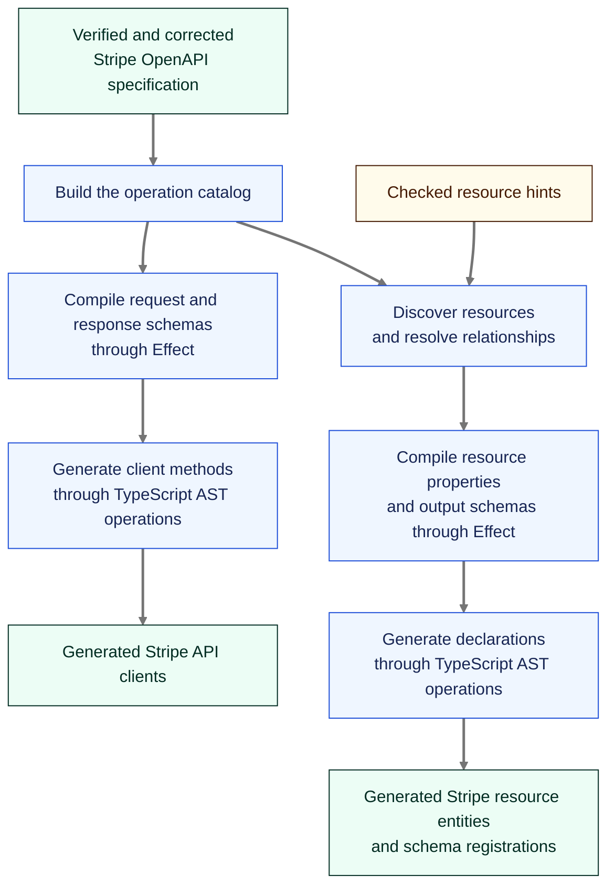
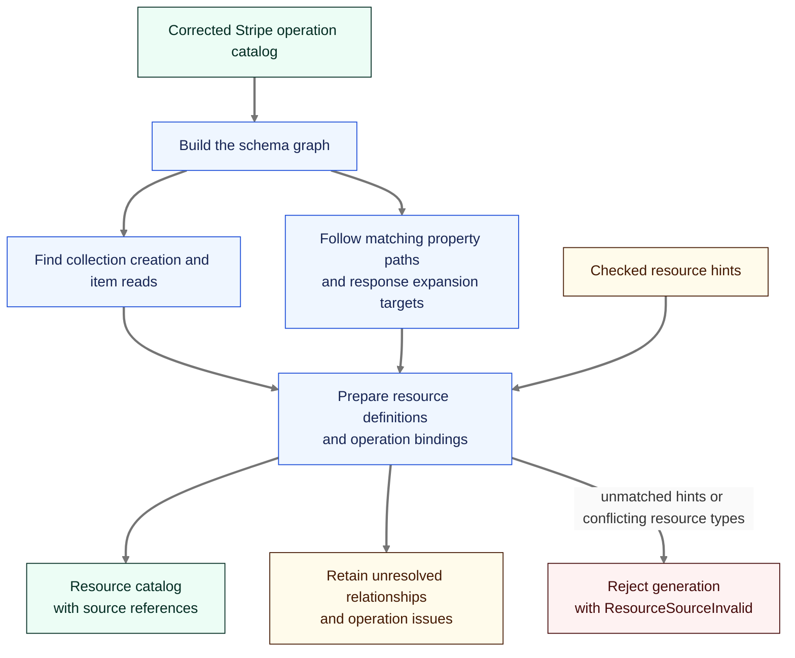
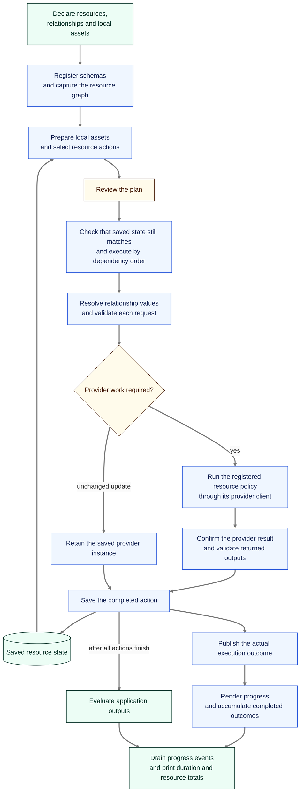

# Generation and resource execution

## Provider definitions and application resources

Nomoss compiles provider definitions into typed resource declarations and clients. Application code passes related entities directly to provider.Resource(props). The relationship schema determines which entities are valid and which of their saved outputs supply the provider request.

A declaration returns its entity before the remote object exists. Core records the dependency and resolves the reference in the shared runtime. The contract applies across providers and inside nested objects and arrays, so a reference still identifies its source after replacement or recovery.

CloudFormation Registry defines which AWS properties an application controls and which identify a resource instance. For Stripe, discovery pairs a creation operation with a read that accepts the returned id. Source configuration supplies the application namespace and webhook exceptions. Both declaration validation and the selected request follow the provider's constraints. [source configuration](../../tools/stripe/openapi-source.json)

## AWS resource declarations and operation clients

CloudFormation Registry defines a resource's properties, identity, and changes that require replacement. Smithy defines the service operations and their errors. Nomoss verifies the revision and checksum of the Registry definitions and service models selected in the manifests. The [native AWS generator procedure](../../tools/awsServiceResources/README.md) explains how to select and regenerate those inputs.

The declaration generator uses the Registry schema and imported relationships to produce a function that accepts resource properties. The function registers the resource with its logical ID and returns an entity that other declarations can reference before the provider assigns an ID.

Each resolved relationship identifies which output supplies a dependent property. Core records the dependency, waits for the source to apply, and supplies the validated output to the dependent request. The Registry still governs the resolved property value. The [resource graph contract](resource-graph.md) explains how references work across resources and providers.

The client generator uses Smithy to produce typed operations. A resource can have a declaration and client operations before Nomoss supports its lifecycle. See the [AWS coverage reference](aws-resource-coverage.md) for current support.

## Provider contracts and resource metadata

Generation checks imported relationship metadata and lifecycle hints against the original Registry schemas. Corrections affect temporary import files. Generated validators use the original definitions so an alternative omitted by the importer remains valid. Import diagnostics identify corrections and unresolved relationships.

Stripe supplies OpenAPI directly. Nomoss converts AWS Smithy models to OpenAPI. The Stripe generator verifies the pinned specification and checks the expected source value for each correction. Resource metadata and client contracts derive from the same corrected document so declarations and requests enforce the same constraints.

Each resolved relationship names its allowed resource types and maps their applied outputs to request properties. Core uses that information to validate the entity and prepare the request. If discovery lacks a target or a required output, the catalog records the source location and reason. The relationship stays unresolved until that information exists.

### AWS generation

<!-- The diagrams embed the theme colors so Markdown can render them independently of the website stylesheet. -->

AWS declarations obtain their properties from Registry schemas and their relationships from imported metadata. Operation clients use Smithy models. Both generators compile validation through Effect and preserve their metadata when they generate TypeScript.

#### Resource declarations

#### API clients

The [AWS client generator](../../tools/awsServiceResources/operationGeneration.ts) retains protocol and request metadata alongside the compiled schemas. The [AWS declaration generator](../../tools/awsServiceResources/resourceDeclarations.ts) retains resource identity and relationship mappings. Registry property constraints continue to come from the original schemas.

### Stripe generation

Stripe uses the corrected operation catalog for client generation and resource discovery. Checked hints select resource operations and supply decisions that the specification leaves unresolved. The [Stripe generator](../../tools/stripe/generator/stripeClientGenerator.ts) carries those operation bindings and relationship mappings into the generated modules.

### Resource identity and lifecycle support

Registry defines AWS resource identity and property classifications. Smithy supplies operation contracts for native policies. A declaration can execute only when the runtime supplies a policy for its type.

Local declarations compile the selected fields directly from their canonical Effect schemas to preserve application validation. A local file resource saves its output path as its identity for later reads.

## Discovery through the schema graph

The catalog retains array items, alternatives, and expansion targets from the source schema graph. Recursive references point to their original definitions. Each operation binding and relationship records where its request parameters and response fields came from. [OpenApiResourceGraph type](../../tools/codegen/resourceDiscoverySchemas.ts)

Unresolved relationships and operation issues remain available in the prepared catalog for inspection. An unmatched hint or conflicting resource type produces ResourceSourceInvalid and stops generation. The [resource catalog service](../../tools/codegen/resourceCatalogs.ts) preserves these outcomes so incomplete mappings remain visible.

Discovery pairs collection creation with an item read when their paths match and both return the same named schema with a required string id. The catalog records the creation schema and maps its returned identity to the read parameter, such as customer. When several pairs qualify, a hint selects one.

Discovery compares request and response paths through objects and arrays. Stripe's response expansion metadata identifies the allowed target types. The catalog retains every alternative and identifies targets with unresolved identity. A difference in property name or structure leaves the relationship unresolved until another source establishes it.

Output names remain compatible with saved records. Source titles and service namespaces distinguish versions that share a resource name. A retention hint names a required output that creation supplies but later reads can omit. For Stripe webhooks, Nomoss retains WebhookSigningSecret and validates it against Stripe's schema.

## Generate lifecycle operations

The corrected specification governs request and response validation. A hint selects among candidate operations or defines a removal action the source leaves open. For Product, removal deactivates the object in Stripe. Its hint selects the update operation and supplies active: false, a value subject to the update request schema.

The schema compiler preserves the selected operation's input, response, and failure types. Callers can validate requests and handle declared failures. Effect infers each service's errors and dependencies from the application Layer graph that supplies them.

Shared services execute resource lifecycle operations from generated configuration. During replacement, Nomoss records each successful creation or removal before the next step. A retry can then resume with the correct owned objects and retained outputs. Dependent references resolve to the successor. Some lifecycle decisions still require handwritten policies. [resource lifecycle requirements](resource-operations.md)

A declaration can contain local lifecycle properties alongside its provider request. Generated configuration selects the request field and can name configuration entries for URL credentials. The shared service applies credentials only to outgoing requests. Saved declarations retain the original application URL.

## Provider directory organization

AWS publishes one client package per service from [providers/aws/generated/clients](../../providers/aws/generated/clients/). Nomoss uses those packages to make AWS calls during stack operations. The [AWS provider guide](../../providers/aws/README.md) shows where to change a service's client, resource declarations, or lifecycle. See the [resource management development guide](../development/effect-native-development.md#develop-resource-management) for the requirements for definitions and type-based resolution.

A change to the provider directory layout preserves public imports, saved command identities, and output names. Generator imports and native schema registrations use the new locations, as do examples and fixtures. Regeneration and application execution thus use the same contracts.

A generated definition can replace handwritten code once the shared lifecycle handles the same requests, results, and failures. Keep provider decisions that still need code with the operation that owns them.

An integration case follows the managed object through its provider result, saved identity, and dependent outputs. It exercises recovery after failure and confirms removal at teardown. Review identifies which handwritten policies and overrides the generated operation replaces.

## Declare resources, execute commands, and save state

Provider resource functions validate declarations and register canonical schemas internally. A declaration returns a typed entity with a stable identity before any provider mutation. Relationship properties accept compatible entities. Ordinary properties keep their provider constraints, and applications can read applied outputs directly.

A create or update uses one application Layer graph from declaration through output evaluation. The stack operations service owns the reviewed plan. The lifecycle service resolves dependencies and persists completed actions. If saved state changes after review, execution requires a new plan before it can change any provider resource. [stack operations service](../../src/core/stack/resourceStackOperations.ts) · [lifecycle service](../../src/core/stack/resourceStackLifecycle.ts)

Core prepares each declared asset when it constructs the plan. The Assets service builds or packages the source, records its SHA-256 digest in the resource properties, and retains the bytes for apply in the same runtime. A later edit requires a new plan to deploy the changed source. State inspection and deletion require no local build. [Assets service](../../src/core/asset.ts)

The dispatcher selects the resource policy from its registered metadata. AWS policies call generated service clients. Stripe policies call generated clients or native local resource operations. Each policy translates the declaration and determines when the provider operation has completed. [provider dispatcher](../../src/providers/resourceCommandPolicyLayer.ts)

The live renderer counts actual outcomes. If a dependent request resolves to its saved inputs, the resource counts as unchanged. After the application evaluates its outputs, the renderer writes the final events and totals. The timer starts after the plan and builds are complete and stops after the last progress write. [live renderer](../../src/core/stack/stackWorkflowRenderer.ts) · [CLI workflow](cli-workflow.md)

Core checks each entity's registered source and allowed type. It saves a serializable reference and request mapping, with the source properties in their own record. The reference identifies the source after a reload, replacement, or failed apply. [resource graph contract](resource-graph.md)

Apply waits for each source and resolves the dependent request from validated applied state. The mapping can require several outputs or a structured value. The dependent mutation proceeds only when the source exists, has a compatible type, and supplies values that satisfy the complete operation schema.

Resource clients, lifecycle services, and output reads share the application's provider configuration and schema registry. A policy interprets a response as an observation. ResourceModel validates its outputs and identity before persistence. An identity mismatch fails the read and preserves the previous record.

The registered policy determines which commands a resource supports. An explicit policy takes precedence over a generated registration for the same type. An unsupported command fails before any provider request. A declaration can therefore exist even if updates or removal still need an explicit policy.

When Stripe omits a webhook signing secret, Nomoss retains the saved value only after ResourceModel verifies the response identity. The currently registered output schema validates older records. Public output names stay compatible with those records.

The published catalog has one entry per resource type. Source references identify its creation operation, relationships, outputs, and other operation bindings. Request schemas and their shared components have one authoritative definition in the corrected provider document. [resource catalog](../../src/providers/stripe/client/generated/resourceCatalog.ts)

## Current limits and acceptance

Generated Stripe declarations register canonical schemas internally and accept typed resource entities at resolved relationship paths. Core checks the source type, obtains its current applied values, and validates the completed request before mutation.

Discovery leaves a relationship unresolved if its target is unknown. Native AWS declarations accept entities where imported metadata identifies an unambiguous relationship. For Stripe, generated updates currently share the read identity mapping. A Customer hint defines how to recognize a deleted object, and the local file resource still needs a handwritten policy. During replacement, the reviewed plan orders ordinary lifecycle operations under generated rules. If a command fails, ResourceCommandExecutionFailed retains the underlying provider or validation error. [resource lifecycle requirements](resource-operations.md) · [unified tracker](../../attempts/dev-attempts_unified-resource-generation.md)

Acceptance exercises entity references through production services. An unrelated type fails before a dependent mutation. Compatible references resolve across providers and nested properties and survive reload or source replacement. Source comparisons check the allowed targets and request mappings throughout the catalog. [resource mapping specification](resource-mapping.md)
