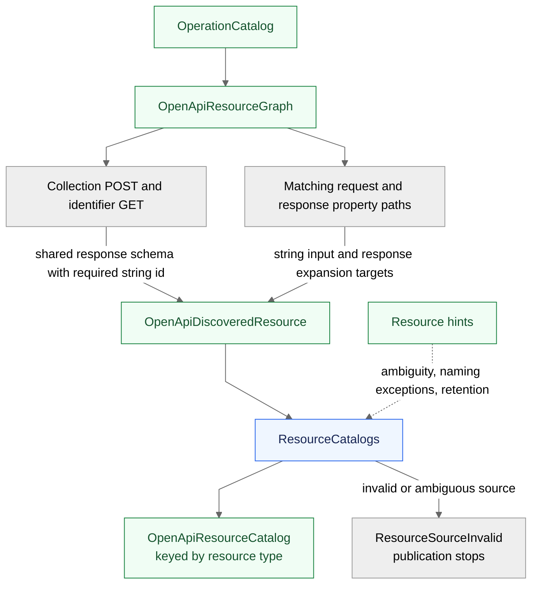

## Provider definitions and application resources

Nomoss compiles provider definitions into resource declarations and clients that validate provider requests and responses. Applications must declare resources through provider.Resource(props) and pass related resource entities directly. Each generated relationship must identify the resource types it accepts and the saved outputs that Nomoss must use in the provider request.

A declaration must return a typed resource entity before the provider creates it. Nomoss must use that entity to record dependencies and validate relationships across providers and inside objects and arrays. Applications must not select an ID, ARN, or scalar output reference to establish a relationship. The core must own resolution through the shared runtime so each provider uses the same rules for saved state, replacement, and recovery.

CloudFormation Registry defines which AWS properties an application can set and which fields distinguish resource instances. For Stripe, discovery examines OpenAPI schemas and operations to pair a creation request with a read that accepts the returned id. The [source configuration](../../tools/stripe/openapi-source.json) supplies the application namespace and webhook exceptions that the provider document does not define. Generated validation must preserve the provider's property constraints, and operation bindings must select the corresponding requests.

## AWS resource declarations and operation clients

Nomoss generates two kinds of TypeScript code because an application's resource declaration and an AWS API request describe different things. The generated `declareAWSQueue` function lets an application describe a desired SQS queue. The generated SQS operation client provides methods such as `createQueue` and `getQueueAttributes` for calls to AWS.

```text
CloudFormation Queue definition → resource generator → declareAWSQueue
Smithy SQS service model        → client generator   → SQS operation client
```

The [CloudFormation Registry definition for AWS::SQS::Queue](../../refs/aws-cdk-service-spec/sources/CloudFormationSchema/us-east-1/aws-sqs-queue.json) specifies accepted resource properties, resource identity, and replacement rules. The [Smithy model for Amazon SQS](../../refs/aws-api-models/models/sqs/service/2012-11-05/sqs-2012-11-05.json) specifies API request fields, response fields, and service errors. The [resource source manifest](../../tools/awsServiceResources/sources/resources.json) selects Registry definitions and records their revisions and checksums. The [SQS source manifest](../../tools/awsServiceResources/sources/sqs.json) also selects the Smithy service model. The source-verification service, `AwsServiceResourceSources`, checks the selected source contents before generation.

The [resource-generation service, AwsServiceResourceDeclarations](../../tools/awsServiceResources/resourceDeclarations.ts), turns the Queue definition into the declaration function application code uses. Within the application's stack declaration, the generated `declareAWSQueue` function registers the desired queue with core's `ResourceGraphBuilder` service and returns a Queue resource entity:

```ts
const queue = yield* declareAWSQueue({
  logicalId: "Events",
  props: { VisibilityTimeout: 45 },
});
```

The logical ID `"Events"` gives core a stable identity within the stack. The `VisibilityTimeout` property specifies the desired queue setting. The Queue resource entity lets another resource declaration depend on the queue before AWS assigns the queue's URL and ARN.

The generated `declareAWSBucket` function accepts the Queue resource entity as a notification destination. Within the same stack declaration, an application can describe an S3 bucket whose object-creation notifications target the queue:

```ts
const bucket = yield* declareAWSBucket({
  logicalId: "Uploads",
  props: {
    NotificationConfiguration: {
      QueueConfigurations: [
        { Event: "s3:ObjectCreated:*", Queue: queue },
      ],
    },
  },
});
```

The [resource metadata importer, AwsResourceMetadataImporter](../../tools/awsResources/awsResourceMetadata.ts), obtains the S3-to-SQS relationship through CDK's `DatabaseBuilder` definition importer. The relationship identifies the SQS Queue's `Arn` output as the value accepted by the S3 Bucket's notification `Queue` property. The resource-generation service uses the relationship to produce a declaration schema that accepts the Queue resource entity at that property.

```text
Queue entity in Bucket properties → recorded dependency → ARN in resolved Bucket request
```

Core uses the recorded dependency to plan resource changes. Core's `ResourceOutputResolver` service substitutes the saved queue ARN when it prepares the bucket request. The generated request schema then validates the resolved bucket properties against the original CloudFormation Registry constraints. The [declaration integration case](../../tests/awsResourceDeclarations.integration.test.ts) exercises this relationship through core's declaration, planning, output-resolution, and saved-state services with controlled provider results. The [AWS native resource tracker](../../attempts/dev-attempts_aws-smithy-resource-generation.md) defines the separate work for native lifecycle execution and delivery permissions.

## Provider contracts and resource metadata

Stripe supplies OpenAPI directly. AWS supplies Smithy models, which Nomoss converts to OpenAPI before schema compilation. The Stripe generator verifies the pinned specification before it applies corrections, and each correction must match its expected source value. Resource metadata and client contracts must use the same corrected document so declaration properties and provider requests retain consistent validation.

The generated declaration schema must identify the resource types accepted by each relationship and map their saved outputs to request properties. The core uses that information to check a related entity and prepare the provider request. When discovery cannot identify a target or its required outputs, the catalog must record the source location and reason. Generation must leave that relationship unresolved until it can establish the mapping.

```mermaid
---
config:
  layout: elk
  theme: neutral
  themeVariables:
    fontSize: "14px"
    background: "#ffffff"
  flowchart:
    curve: stepAfter
    padding: 8
    wrappingWidth: 220
    nodeSpacing: 16
    rankSpacing: 24
---
flowchart LR
  subgraph Clients["Generate clients for provider API calls"]
    direction LR
    Stripe["Stripe's OpenAPI specification describes the accepted inputs and possible responses for Stripe API calls."]
    Smithy["AWS's Smithy service models describe API inputs, responses, errors and request protocols."]
    Conversion["Smithy's OpenAPI converter translates AWS service models into OpenAPI so AWS and Stripe can use the same schema compiler."]
    Operations["The operation catalog associates each API operation with its request and response schemas for client generation."]
    ClientCompilation["Effect Schema compiles API request and response schemas into TypeScript types and runtime validators."]
    StripeGenerator["ts-morph and TypeScript AST operations produce Stripe client methods that validate arguments and decode responses."]
    AwsClientGenerator["ts-morph and TypeScript AST operations produce AWS client methods that execute through the shared AWS request client."]
    StripeClient["Applications call Stripe APIs through generated methods with validated requests and responses."]
    AwsClient["Applications call AWS APIs through generated methods with validated requests and responses."]

    Stripe -->|"verified specification and checked corrections"| Operations
    Smithy --> Conversion --> Operations
    Operations -->|"operation payload schemas"| ClientCompilation
    ClientCompilation -->|"compiled types and validators"| StripeGenerator
    ClientCompilation -->|"compiled types and validators"| AwsClientGenerator
    StripeGenerator --> StripeClient
    AwsClientGenerator --> AwsClient
  end

  subgraph Declarations["Generate resource declarations for applications"]
    direction LR
    ResourceOperations["Resource discovery compares API request and response schemas to pair creation calls with reads of the created resource."]
    Registry["AWS CloudFormation Registry resource schemas in the CDK service-spec checkout describe writable properties, resource identities and replacement rules."]
    Resources["The resource catalog records each resource's declaration schema, saved outputs and operation mappings for declaration generation."]
    ResourceCompilation["Effect Schema produces TypeScript types and runtime validators for declared properties and saved resource outputs."]
    Metadata["Resource identity and relationship mappings let core locate saved resources and resolve values in dependent requests."]
    ResourceGenerators["ts-morph and TypeScript AST operations produce resource schemas and declaration functions that register desired resources with core."]
    StripeResources["Applications use generated Stripe resource declarations to describe desired Stripe resources and pass related resource entities as properties."]
    AwsResources["Applications use generated AWS resource declarations to describe desired AWS resources. Core validates their properties and saved outputs with the generated schemas."]

    ResourceOperations -->|"corrected schemas and selected operations"| Resources
    Registry -->|"identity and property classifications"| Resources
    Resources -->|"source-derived schemas"| ResourceCompilation
    Resources --> Metadata
    ResourceCompilation -->|"compiled types and validators"| ResourceGenerators
    Metadata --> ResourceGenerators
    ResourceGenerators --> StripeResources
    ResourceGenerators --> AwsResources
  end

  style Clients fill:#ffffff,stroke:#cbd5e1,color:#0f172a
  style Declarations fill:#ffffff,stroke:#cbd5e1,color:#0f172a
  linkStyle default stroke:#15803d,stroke-width:2px,color:#166534

  classDef source fill:#f0fdf4,stroke:#15803d,color:#14532d
  classDef service fill:#eff6ff,stroke:#2563eb,color:#172554
  class Stripe,Smithy,Registry,Metadata,StripeClient,AwsClient,StripeResources,AwsResources source
  class Conversion,Operations,ClientCompilation,StripeGenerator,AwsClientGenerator,ResourceOperations,Resources,ResourceCompilation,ResourceGenerators service
```



AWS resource generation must preserve the identity and property classifications defined by CloudFormation Registry. Smithy defines the outer Cloud Control requests and responses. Cloud Control returns both the resource model and an Identifier used by later requests. Nomoss must retain that Identifier separately from the identity fields inside the model because subsequent Cloud Control operations require the returned value.

Local resources must retain the validation from their canonical Effect schemas. Generation must compile selected native fields directly so the generated declarations preserve the application's validation rules. A local file resource must save its output path as its identity so later reads can locate the published file.

## Discovery through the schema graph

Catalog entries must retain the source definitions for properties, array items, alternatives, references, and expansion targets. The [OpenApiResourceGraph type](../../tools/codegen/resourceDiscoverySchemas.ts) describes those connections. Recursive references must remain links to their definitions so discovery can follow them without duplicating schemas. Each operation binding and relationship must retain the document locations used to select its request parameters and response fields.



Discovery pairs an operation that creates an item in a collection with a read when both return the same named schema with a required string id. Their collection and identifier paths establish which operations belong together. The catalog records the creation schema and maps the returned identity to the read parameter, such as a response id used in a parameter named customer. When several operations qualify, a hint must identify the intended pair.

Discovery compares matching request and response paths through objects and arrays. Stripe's response expansion metadata identifies the possible resource types for a relationship. The catalog must retain every alternative and record any target whose identity it cannot establish. A request property whose name or structure differs from the response remains unresolved because the current rules have no evidence for that relationship.

Generated output names must remain compatible with saved records. Resource names must retain the source title and service namespace where versions would otherwise conflict. When creation returns a required value that later reads can omit, a hint must name the saved output and require its retention. For example, Stripe returns a webhook signing secret during creation and omits it from later reads. Nomoss must preserve that value as WebhookSigningSecret and validate it against Stripe's schema.

## Generate lifecycle operations

The generator must compile request and response validation from the corrected provider specification. When discovery finds several possible operations, a hint must select the intended operation. A hint must also select a removal action that discovery cannot infer. For example, Nomoss removes a Product from an application by deactivating it in Stripe. The Product hint selects Stripe's update operation and supplies active: false, which must pass that operation's request schema.

Generated operations must preserve the selected operation's input, response, and failure types so callers can validate requests and handle its declared failures. The generator must compile validation through the existing schema compiler. Effect must infer each service's errors and dependencies, and the application's shared Layer graph must supply those dependencies during execution.

Shared services must use the generated configuration to create, read, update, and remove resources. Replacement must record each completed creation or removal before it proceeds, so a retry can continue after failure without repeating a successful creation or losing a managed object. It must preserve retained outputs and update dependent references to the replacement's identity. The [resource lifecycle requirements](resource-operations.md) define these operations and identify the decisions that still require handwritten policies.

A declaration can retain local lifecycle properties beside its provider request. Generated configuration must identify the field that supplies that request, so execution sends the provider's values. It may also name configuration entries for URL credentials. Shared execution must apply those credentials to outgoing requests while saved declarations retain the application's original URL.

## Provider directory organization

Each provider must keep its API client and generated contracts in client/, shared resource management in management/, and resource-specific declarations, schemas, and native operations in `resources/<resource>/`. A provider-level runtime.ts must assemble Layers, and index.ts must provide the public exports. Generated registrations must execute through the shared resource management services. Each handwritten resource operation must document the behavior that generation cannot yet express.

Moving provider files must preserve public imports, the identities used to dispatch saved commands, and saved output names. Generator imports, native schema registrations, examples, and fixtures must use the new locations so regeneration and application execution continue to use the same contracts.

When generated configuration replaces a handwritten policy, the shared services must execute the same provider requests and handle the same responses and failures. Production registrations must use that configuration, and the replaced policy, wrapper, and runtime override must be removed.

Application integration coverage must verify the provider result, saved identity, dependent outputs, recovery after failure, and removal of the managed object. Review must identify which handwritten policies, wrappers, and runtime overrides the generated operations replace, separately from the test results.

## Declare resources, execute commands, and save state

Provider resource functions must validate declarations and register their canonical schemas internally. Each function must return a resource entity with a stable declaration identity and resource type, without a provider mutation. Relationship properties must accept compatible entities directly. Ordinary properties must retain their provider constraints, and ordinary output APIs must remain available for application values.

The core must verify each related entity against the registered source resource and its allowed type. It must save a serializable reference and the request mapping without a copy of the entity's properties or object graph. That reference must remain usable after a reload, replacement, or failed apply. The [resource graph contract](resource-graph.md) defines the required behavior.

Apply must wait for each source resource and obtain the mapped values from its validated applied state. A mapping may require several outputs or a structured request value. Before a dependent mutation, the complete request must pass the provider operation schema. A missing source, incompatible entity, unresolved mapping, or invalid value must stop that mutation.

The application's Layer graph must supply the same provider configuration and registered schemas to resource clients, lifecycle services, and output resolution. Provider policies interpret responses as observations, and ResourceModel must validate the outputs and identity before persistence. A read that returns another resource's identity must fail and leave the previous saved state intact.

The selected resource policy determines which lifecycle operations an application can execute. Explicit policies take precedence over generated registrations for the same resource type and retain their specialized behavior. When a policy has no operation for a requested command, it must reject the command before sending a provider request. A generated declaration may therefore exist while updates or removal still require an explicit policy.

When Stripe omits a webhook's signing secret from a read, Nomoss must retain the saved secret after ResourceModel verifies that the response has the saved identity. ResourceModel must validate older saved records against the currently registered output schema, and application output names must remain compatible with those records.

The published [resource catalog](../../src/providers/stripe/client/generated/resourceCatalog.ts) must retain one entry per resource type, with source references for creation, relationships, outputs, and operation bindings. Canonical schemas must come from the corrected provider document. The catalog must not duplicate request schemas or their shared components.

## Current limits and acceptance

Stripe uses the provider directory organization described above. Its generated declarations register canonical schemas internally and accept typed resource entities at resolved relationship paths. Core execution checks the source type, obtains its current applied values, and validates the completed request before mutation.

Discovery still leaves relationships unresolved when it cannot identify their targets. Generated native AWS declarations accept resource entities at unambiguous relationship properties identified through CDK metadata. Stripe's local file resource still requires a handwritten policy for native operations, and generated updates require the same identity mapping as reads. Customer's generated registration selects its deleted-response rule through a hint. ResourceCommandExecutionFailed identifies a failed command and retains its provider or validation error. Replacement uses generated rules to compose ordinary lifecycle operations in the reviewed plan. The [resource lifecycle requirements](resource-operations.md) describe these contracts, and the [unified tracker](../../attempts/dev-attempts_unified-resource-generation.md) records the remaining work.

Acceptance must demonstrate that applications pass entities directly and that unrelated resource types fail before a dependent mutation. Production services must preserve relationships across providers, nested properties, saved state, and source replacement. Source checks must establish that generation retains the allowed targets and request mappings across the complete catalog. The [resource mapping specification](resource-mapping.md) defines the remaining requirements for discovery and provider operations.
